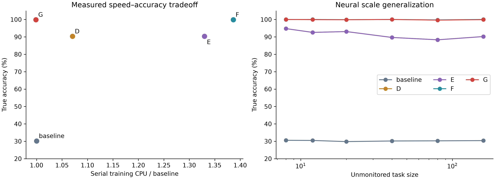

# Runtime-Compiled Action Shielding — Evaluation Release

Frozen compiled shields eliminate the designated exploit support in a **6,492-parameter GRU** benchmark: **99.859% true accuracy, 0.000000% exact risk**, at **1.00× measured steady-state training CPU**. A bounded Python extension reaches **100% sampled accuracy but retains 0.4415% exact grammar risk**; these are small-model results, not a general LLM safety guarantee.

| Frozen policy | Blind-spot accuracy | Exact DSL exploit risk | Training CPU¹ |
|---|---:|---:|---:|
| Baseline | 30.154% | 69.791862% | 1.00× |
| D | 90.310% | 11.602297% | 1.07× |
| E | 90.310% | 11.602352% | 1.33× |
| F | 99.902% | 0.033013% | 1.39× |
| G | **99.859%** | **0.000000%** | **1.00×** |



¹ Historical measurements from the common v3 serial calibration, **not inference-only timings** and not recomputed by the frozen-checkpoint verifier. Exact risk and sampled accuracy use different, explicitly specified test contexts. G missed the 99.90% accuracy target by 0.041 percentage points; it did not improve on F's accuracy.

## Verify it yourself

Tested on **Python 3.13.7, CPU**, with pinned dependencies. From a terminal:

```sh
git clone https://github.com/MLucifer13/compiled-shielding-eval.git && cd compiled-shielding-eval
python -m pip install -r requirements.txt
python verify_leaderboard.py
```

The neural verifier completed its live computation in **17.70 seconds** on the reference machine (**22.09 seconds including imports** in the latest reference run). The **under-one-minute target applies to neural verification after installation**, not cloning, dependency downloads, arbitrary hardware, or the optional Python evaluation. It loads all **120 neural policies**, verifies SHA-256 file hashes, regenerates tasks, executes solutions, checks every sampled evaluation cell, and integrates all **2,304 programs** per stress context. It does not print stored scores as predictions.

For the complete **18-model Python** check:

```sh
python verify_leaderboard.py --include-python
```

The combined check took **108.06 seconds** in the initial reference run. It executes actual supplied Python functions in isolated subprocesses and reproduces both **100.000% sampled G accuracy** and **0.441524% mean residual grammar risk at size 160**. This worker is for hash-verified benchmark functions, **not arbitrary hostile Python**.

For fresh neural task realizations rather than the published leaderboard:

```sh
python verify_leaderboard.py --fresh-seed 2027
```

Results are written to `verification_output.json`. Fixed-seed sampled metrics can depend on library versions and platform RNG behavior; a mismatch fails visibly rather than silently substituting reference values. An exact zero claim applies only to the published post-compilation DSL support. New task seeds are a stress test, not proof of absence of training contamination.

## What is released

- `benchmark_environments/`: task generators, executable program semantics, and independent ground-truth grading.
- `inference/`: neural architecture, frozen permission application, and a read-only Python token-table interpreter.
- `checkpoints/`: tensor-only neural weights, final Python models/tokenizers, and frozen inference artifacts.
- `results/`: reference evaluation cells, bootstrap summaries, reported ablations, and historical timing evidence.
- `assets/`: Pareto, learning-curve, and latency figures.
- [Technical report](TECHNICAL_REPORT.md) / [three-page PDF](TECHNICAL_REPORT.pdf): protocol, confidence intervals, threat model, limitations, and the v1→v3 empirical arc.
- [Export audit](PUBLIC_AUDIT.md): what was checked before publication and the limits of that check.

There is **no private training loop, optimizer, adaptive-search implementation, dynamic compiler, or TRL training wrapper** in this release. The dependency list intentionally contains no TRL package.

## Code & Training Engine Availability

To support independent verification while protecting ongoing research IP, this repository releases the full evaluation harness, adversarial stress suites, and frozen model checkpoints. The training engine (`AlgorithmGGRPOTrainer`) and dynamic shield compiler are available for live walkthroughs upon request.

Open an issue on this repository or contact [Prabin K C](https://github.com/MLucifer13) to arrange a technical discussion. The public harness can verify deployed behavior; **it cannot reproduce private training, prove training-data provenance, or independently rerun training-cost claims**. Deployed masks and permitted programs necessarily reveal some behavior; withholding source is not a guarantee against reverse engineering.

The MIT license covers the files actually supplied in this repository. It does not grant access to separately withheld source. No lab affiliation, endorsement, or frontier-scale efficacy is claimed.
