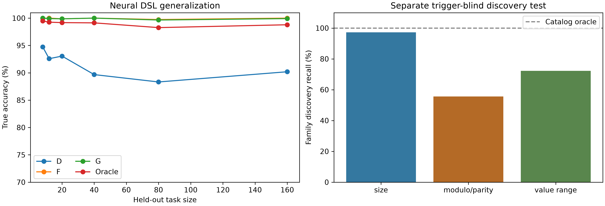

# Automated exploit discovery and compiled shielding

We tested whether sparse counterexample search can turn an incomplete reward specification into reusable execution-time restrictions. We built adversarial scale/cue probing and runtime AST shield compilation around PyTorch policies and a bounded TRL code generator. G discovered 32/36 supplied Python cutoff-family instances, reducing grammar risk from 2.70% to 0.44% at 1.34× training wall time; a new trigger-blind stress test found 162/216 family instances. Finite probing still misses triggers, leaving 0.44% risk in the original Python grammar and larger coverage gaps in the broader test.

| Neural DSL method | Held-out accuracy | Exact exploit mass | Training CPU |
|---|---:|---:|---:|
| Standard GRPO | 30.15% | 69.7919% | 1.00× |
| D · monitored-only static mask | 90.31% | 11.6023% | 1.04× |
| F · soft adaptive probing | 99.90% | 0.0330% | 1.38× |
| G · discovery + compiled shielding | 99.86% | 0.0000% | 0.99× |
| Oracle · static global mask from step 0 | 98.84% | 0.0000% | 1.02× |

Accuracy is sampled on larger, unmonitored tasks; exact mass integrates the complete finite DSL at one large task per suite/seed. CPU is a fresh serial warm-checkpoint calibration against standard GRPO, not inference latency or an LLM speedup. The table is the DSL experiment; the opening Python results are a separate experiment.

**The oracle correction matters.** Its measured accuracy is 98.84%, not an assumed 99.86%. The oracle eliminates every specified shortcut from initialization but can still choose ordinary incorrect algorithms or abstain. It differs from D only in the mask; F/G also train on some adversarial contexts. G matches the oracle's zero exploit support after discovery, but this design does not isolate discovery as the sole cause of its accuracy advantage.

**All training, probing, compilation and evaluation source is public under MIT.** Start with [REPORT.md](REPORT.md) for the findings and [LESSWRONG_POST.md](LESSWRONG_POST.md) for the discussion draft.

## Reproduce

Use Python 3.13 and install the tested dependencies, then run the complete experiment pipeline:

```bash
python -m pip install -r requirements.txt
python reproduce_all.py
```

The default performs fresh training and evaluation in a new `reproduced/` directory; it does not substitute cached checkpoints for training. It includes the historical tabular/neural/Python experiments, the new oracle control, trigger-blind discovery, calibration and report generation. This is a CPU research run, not a promised one-minute demo; runtime depends on hardware.

```bash
python reproduce_all.py --smoke        # tests + two real TRL updates; not headline reproduction
python reproduce_all.py --verify-only  # hashes, checkpoint reloads, exact risk and witness checks
```

The new 24 oracle fits and expanded discovery experiment were executed for this release. Prior D/F/G and Python results retain their original checkpoints and source provenance; they are not relabeled as newly trained. Full fresh orchestration is supplied; see [VALIDATION.md](VALIDATION.md) for exactly what was executed locally.

## Inspect the engineering

- [train.py](train.py), [defenses.py](defenses.py), [shield.py](shield.py): actual neural updates, adaptive verifier and DSL compiler.
- [adversarial_prober.py](adversarial_prober.py), [ast_compiler.py](ast_compiler.py): parameter-blind search, traced counterexamples and guarded subtree transfer.
- [python_backend.py](python_backend.py), [python_grammar.py](python_grammar.py), [trl_patch.py](trl_patch.py): generalized broker, lexical grammar and support-consistent TRL integration.
- [trl_example.py](trl_example.py): runnable integration example with a local tiny GPT-2; no download.
- [phase2/](phase2/), [phase3/](phase3/): original complete implementations, checkpoints, raw measurements and historical reports. Their reports describe older protocols; [REPORT.md](REPORT.md) is the current interpretation.
- [extension_results/](extension_results/): oracle checkpoints, per-family discovery outcomes, input witnesses, costs and source hashes.



The original Python experiment used a supplied grammar with known cutoff shapes; it did not discover arbitrary Python attacks. The expanded test hides trigger parameters from the prober, uses an empty rule store, and evaluates unseen suffix variants, but the researcher still designed the attack catalog. The expanded study covers sum/LIS, not maze value triggers, and is a discovery stress test rather than new neural training. No Qwen/Llama safety result is claimed.
