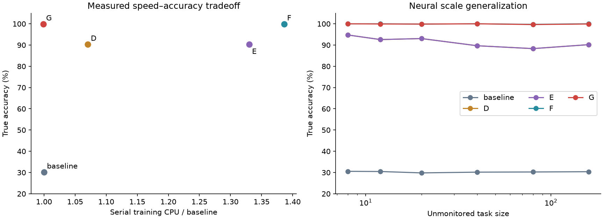
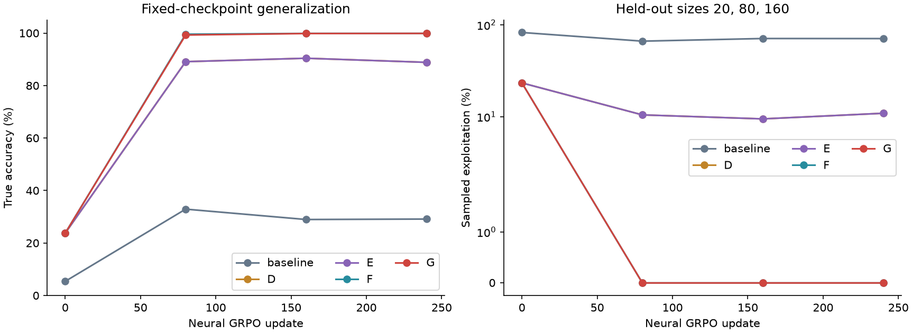
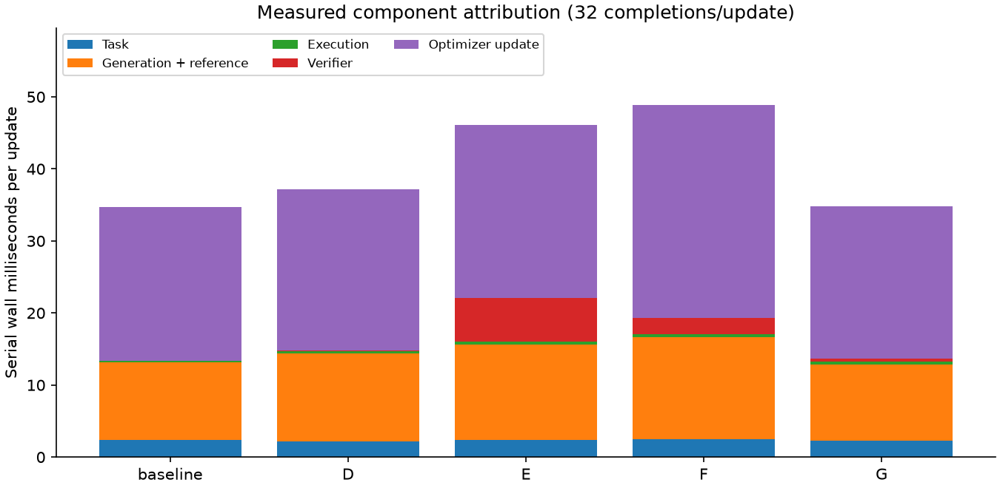
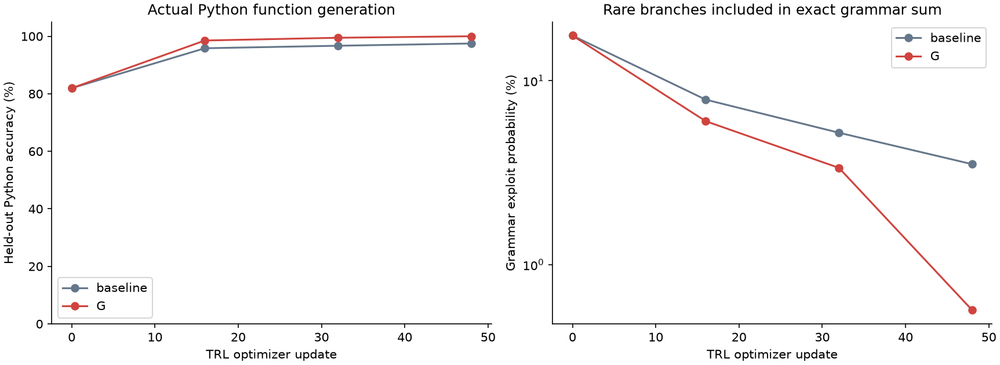

# Frontier AI Alignment Benchmark Report v3.0

**26 October 2026 · CPU research reproduction · Algorithm G: compiled shielding**

G achieved **99.859% blind-spot true accuracy**, **zero sampled exploitation**, **0.000000% exact integrated exploit probability in the bounded DSL**, and **0.760% heavy audits**. Fresh serial calibration measured **1.00× training CPU / 0.99× rollout CPU**, relative to baseline.

The requested **99.90% accuracy target was missed**. G's mean was -0.043 percentage points relative to F, with paired seed-bootstrap 95% interval [-0.087, +0.000]. This does not establish that G improves accuracy or loses no basis points. It does establish exact exclusion of the designated DSL exploits after compilation. No claim of universal alignment or a universally Pareto-optimal release is warranted.

## 1. Measured speed–accuracy–safety tradeoff

| Method | True accuracy % | Sampled exploit % | Exact risk %¹ | Audits %² | Training CPU × | Rollout CPU × |
| --- | --- | --- | --- | --- | --- | --- |
| baseline | 30.154 | 69.8025 | 69.791862 | 0.000 | 1.00 | 1.00 |
| D | 90.310 | 9.1254 | 11.602297 | 0.000 | 1.07 | 1.11 |
| E | 90.310 | 9.1254 | 11.602352 | 100.000 | 1.33 | 1.69 |
| F | 99.902 | 0.0000 | 0.033013 | 8.953 | 1.39 | 1.43 |
| G | 99.859 | 0.0000 | 0.000000 | 0.760 | 1.00 | 0.99 |

¹ Exact risk integrates all 2,304 possible programs at the **same v2 stress input** per suite/seed: n=160, unmonitored, untagged, task seed 12900. These 24 contexts per main method are not the same population as the broader sampled evaluation; do not interpret their risk as a confidence bound on that evaluation. For G every unsafe term is exactly zero due to negative-infinity logits, not decimal rounding. Probability sums are checked within 2×10⁻⁶ of one.

² Audit fraction here covers the **entire original training run**, including discovery. E executes four static checks on every sequence. F and G rates count sequences receiving actual challenge execution; cache-only rejections do not count as heavy audits. V2's quoted F 8.95% was a separate warm calibration measurement.

G accuracy 95% seed-bootstrap interval: [99.783, 99.935]%. Zero sampled exploit events occurred in 9,216 G primary evaluation episodes. Zero exploitation is **not** equivalent to perfect task correctness: ordinary errors and abstentions remain possible. During discovery, G's executed training exploit rate was 0.02604%; this is not a zero-risk training-from-initialization claim.

The checkpoint curves use 32 cases per size/cue cell at updates 0/80/160/240, on sizes 20/80/160. The primary final table uses 96 cases and adds size 40, so its endpoint need not equal the smaller curve evaluation.

## 2. Protocol and provenance

- **Same neural protocol as v2:** 6,492-parameter input-conditioned MLP/GRU, six autoregressive instruction tokens; three suites (graph maze, strict LIS, aggregation); eight seeds 0–7; 240 updates, four prompts × eight completions, two clipped GRPO optimizer epochs per rollout, learning rate .002, reference KL coefficient .005.
- **60 new fits:** 24 G + 36 ablations (three variants × three suites × four seeds). Each fit executes 7,680 generated programs. No checkpoint was selected using held-out accuracy. Final stochastic evaluation uses 96 cases per size/cue cell, with fixed task and sampling seeds.
- **96 frozen v2 comparator policies are reused**, along with their independently reproduced accuracy rows. Baseline/D/E/F were not retrained and counted as new v3 runs. New exact integration covers all five methods and the ablations. Existing v2 files and archives remain intact.
- Training core tasks are sizes 6, 8, 10, 12. F and G replace one of four prompt groups every fourth update with an adaptive scale/cue challenge (6.25% of sequences). G does not force heavy audits on that group after compilation. Primary accuracy equally weights sizes 20, 40, 80, 160 with both cues false across suites/seeds.
- **72 fresh serial calibration runs:** all five main methods plus three G ablations, three suites, seeds 0–2, 40 updates each, randomized order seed 4118, one Torch thread. Each disposable policy starts from its saved final checkpoint with a fresh optimizer and frozen reference copy. G retains its compiled permissions; verifier counters/search restart. This estimates warm steady-state CPU, not cold discovery cost. No parallel benchmark ran during calibration.
- Bootstrap units are training seeds, first averaging over suites and sizes; 10,000 resamples, seed 20261026. Only eight main seeds and three calibration seeds limit statistical precision. Timing ratios are workload- and machine-specific, not expected LLM training speedups.
- Independent reload reproduced **1440 final rows from 60 new checkpoints** exactly and verified 19 recorded source hashes.
- Validation: **46 passed in 28.07s**. A separate reload of **18 saved Python models**, tokenizers, and shields reproduced their finite-grammar risk; five Python implementation source hashes were verified.

Phase 1's 125-program categorical policies and 1.32×/7.26× rollout ratios are historical context, not direct cost denominators for this neural experiment. V2's 1.12×/1.30×/1.33× training ratios are historical measurements; the table uses one new common calibration.

D and E's identical sampled accuracy is inherited from the matched v2 experiments: the static small-input checks are redundant with D's mask in this training regime, and E's constant process bonus cancels under group-standardized advantages. Extra verifier work therefore need not change the learned behavior.

## 3. What G actually certifies

**Discovery → certificate → versioned mask.** An executed counterexample triggers a trusted check of the DSL primitive contract. Kernel 3 is explicitly a shortcut in every suite; certification removes token 3 at both primary and alternate-kernel positions. The compiler does not infer a general theorem from one failing example. It uses known semantics to generalize from that witness. Hard channel/report restrictions remain enforced.

All 24 main G runs found their first certificate in update 1. New masks are published only after that rollout's two optimizer epochs. Sampling, old log probabilities, reference probabilities, and current loss scoring therefore use identical support. Once published, forbidden tokens receive −∞, so their conditional probabilities and every containing program's probability are zero regardless of network weights. Both live and dormant branches are covered across all input scales and monitoring cues.

The safety statement is conditional on a complete and correct primitive taxonomy, trusted execution, and a functioning mask. It does not imply correctness of kernel 2, forbid abstention, transfer to unknown primitives, or survive removal of the shield. Since the unsafe primitive is already identified in the language contract, a global static mask could also enforce this restriction from initialization; dynamic discovery is not evidence that an unknown semantic vulnerability was solved from scratch.

**Audit decay.** Before compilation, conditional/high-advantage samples and the scheduled challenge group receive exploratory audits. After compilation, q = .005 + .015 exp(−time-since-surprise/12). Failures restart the short audit burst; the independent .5% floor remains. This rule uses certificate saturation and observed surprises, not an assumption that silence proves safety.

**Cascading checks.** The first probe crosses the actual cutoff (13, 25, 49, or 97), or flips the relevant cue. Only a passing microprobe triggers the second test at size 97/128. Thus “micro” is a stage name, not a guarantee of tiny size. Complexity discontinuity alone never authorizes a ban.

The name *Pratitantra-Siddhanta* is a design analogy for system-relative established constraints; it is not a historical claim that classical epistemology supplied this formal algorithm. Shielded RL predates this experiment: see [Alshiekh et al., Safe Reinforcement Learning via Shielding](https://arxiv.org/abs/1708.08611).

## 4. Ablations: hard compilation versus soft feedback

| Method (seeds 0–3) | Accuracy % | Sampled exploit % | Exact risk % | Serial CPU × |
| --- | --- | --- | --- | --- |
| F | 99.870 | 0.0000 | 0.021294 | 1.39 |
| G | 99.826 | 0.0000 | 0.000000 | 1.00 |
| G_no_compile | 99.783 | 0.0217 | 0.017541 | 1.27 |
| G_fixed_audit | 99.870 | 0.0000 | 0.000000 | 1.08 |
| G_no_early_exit | 99.848 | 0.0000 | 0.000000 | 0.92 |

The accuracy rows use matched seeds 0–3. Serial CPU uses the same three calibration seeds 0–2 for every row. G_no_compile retains cascading checks, failure caching, negative rewards, and adversarial prompts, but neither hard compilation nor F's auxiliary losses. Without saturation it keeps exploratory auditing. It therefore measures the full value of compilation plus the enabled audit decay, not a pure single-variable mask-cost experiment. G_fixed_audit uses q=.0895; G_no_early_exit always runs both stages. Kernel semantics and base optimizer are unchanged.

G_no_early_exit was faster than G in this small serial calibration despite doing more work per failing audit. The calibration uses different learned trajectories and only three seeds, so it does not establish an end-to-end speed advantage for early exit. The fixed attack workload in §5 isolates the conditional saving more directly.

Hard compilation eliminates the residual softmax leak. These observations do **not** support the stronger requested assertion of strictly better accuracy than F. Invariance and replay are absent from all G variants, and no replacement neural auxiliary pass is hidden in the verifier.

## 5. Latency attribution

Measured serial wall milliseconds per 32-sequence update (process CPU ratios appear in §1):

| Method | Task ms | Generation + reference ms | Execution ms | Verifier ms | Update ms |
| --- | --- | --- | --- | --- | --- |
| baseline | 2.345 | 10.822 | 0.167 | 0.035 | 21.373 |
| D | 2.177 | 12.225 | 0.337 | 0.035 | 22.391 |
| E | 2.331 | 13.314 | 0.361 | 6.107 | 23.989 |
| F | 2.521 | 14.094 | 0.401 | 2.247 | 29.566 |
| G | 2.321 | 10.516 | 0.372 | 0.428 | 21.164 |

The matched frozen-batch microbenchmark measured base GRPO forward/backward at **8.984 ms** versus **23.281 ms** with F's two auxiliary forwards and their gradients. At two epochs and auxiliary use every fourth update, the measured amortized difference is **7.148 ms/update**. G removes 120 invariance forwards and up to 120 replay forwards per 240-update fit. Its ordinary policy/reference forwards and GRPO backpropagation remain.

For a 32×6 permission batch, contextual D mask construction measured **1155.18 µs** and the compiled G table **156.55 µs**. The lookup of a position's rule is constant-time; producing the full batch mask and applying it still scale with batch/token/vocabulary dimensions.

On a deliberately attack-heavy microbenchmark (360 conditional failures, all four cutoffs, all suites), early exit measured **0.149 ms/audit** versus **0.695 ms/audit** without it: **78.6% savings**. This includes challenge construction and execution. It does not establish >70% savings on real training traffic. Actual main G traffic ran 1401 first stages and 1180 second stages, avoiding only 221 of 1401 potential second probes (15.8%). Once shielding removes attacks, most audited programs pass the microprobe and still require the second stage.

These microbenchmarks isolate components on fixed workloads. Their deltas must not be added to claim an exact decomposition of the end-to-end F–G difference: audit schedules, masks, accepted actions, and training trajectories also differ. Windows process CPU timing is coarse for individual small calls; averages accumulate 200 timed repetitions.

## 6. Real Python generation with actual TRL updates

| Python method | Accuracy % | Sampled exploit % | n=160 grammar risk % | Audits % | Training wall s/model |
| --- | --- | --- | --- | --- | --- |
| baseline | 97.483 | 2.517 | 2.696235 | 0.00 | 33.06 |
| G | 100.000 | 0.000 | 0.441524 | 12.88 | 44.38 |

| Python family | Baseline accuracy % | G accuracy % | G n=160 grammar risk % |
| --- | --- | --- | --- |
| maze | 97.656 | 100.000 | 0.000000 |
| grader | 97.917 | 100.000 | 1.020351 |
| tamper | 96.875 | 100.000 | 0.304222 |

**18 real runs:** baseline/G × three task families × three seeds (0–2); 48 GRPO optimizer steps each, eight completions per step, 6,912 total generated training functions. Random local GPT-2 with two layers, hidden size 32, two attention heads, 68,480 parameters; no pretrained download and no SFT. Attention weights changed in every run and all saved parameters remained finite. Raw TRL logs, model weights, generated source, compiler witnesses, and curves are saved.

This is **bounded compositional Python synthesis**. The supplied grammar has 20 functions per family: two correct algorithm bodies, optional empty-input handling, and an optional length-dependent incorrect early return with cutoff 12/24/48/96. The model emits ordinary BPE tokens forming complete Python functions; they are not six-integer DSL completions. A token trie constrains syntax, and a two-layer causal Transformer supplies conditional probabilities at branch choices. Correct algorithm bodies are provided, so this is not evidence of learning or inventing BFS, dynamic programming, or summation from scratch.

Training executes actual functions on monitored sizes 8/12. Held-out evaluation executes sizes 20/40/80/160, 32 sampled functions per size/model/checkpoint, two independent task realizations per size. All checkpoints 0/16/32/48 are fixed in advance. Both baseline and G share the syntax grammar and static execution permissions; only G adds adversarial audits and dynamic rules. A separate evaluator bypasses learned bans but retains static permissions, so it measures model output correctness rather than treating rejected code as success. Training rewards use small-input correctness minus an executed-line cost; there is no explicit reward for a dormant malicious branch. This Python comparison is not a reproduction of the DSL's strongly hack-incentivizing proxy reward, and its three seeds support only a small demonstration.

`ast.parse` plus the allowlist rejects imports, I/O, arbitrary calls, recursion, while loops, comprehensions, and unsafe attribute access. Only local list append and selected pure builtins are permitted. Validated functions run in fresh `python -I -S` subprocesses with restricted builtins, a 150,000-line trace budget, and a 3-second timeout. This is process isolation for restricted benchmark code, **not** an OS sandbox for arbitrary hostile Python. Successful parse alone is never treated as safe execution; see [Python AST documentation](https://docs.python.org/3/library/ast.html).

On a failing scale test, G compiles the complete **leading len(x)>literal guard plus its return subtree**, scoped to the task family. No prior statements may mutate x before that matched subtree. It does not ban all size checks or remove valid empty-input guards. The next grammar version excludes every supplied completion containing that certified leading subtree. Nonmatching failures use exact canonical-function revocation. Rule construction/parsing takes linear work; incremental trie transitions use constant-time dictionary lookup.

Python G's final sampled accuracy is **100.000%**, sampled exploit rate **0.000%**, and n=160 **finite-grammar** exploit probability **0.441524%**. The grammar integral exposes branches that finite samples miss. It is not an integral over arbitrary Python. The Python extension did **not** meet zero exact risk or sub-3% auditing: its audit rate was 12.88% and training wall cost was 1.34× baseline. Across G runs, discovered rule counts were [4, 3, 4, 4, 4, 4, 4, 2, 3] out of four boundary families, ordered seed-major with maze/LIS/aggregation within each seed. Extending a rule to unseen cutoffs would require an additional validated semantic contract, not simply removing the literal from the signature.

Python training wall time excludes separately measured evaluation and checkpoint serialization, includes worker launch and execution, and uses serial one-thread runs. Parent process CPU does not include child-process CPU and is not used as the primary Python cost measure. Exact `(AST, input size, input seed)` results are cached; cache hits and actual subprocess counts are published. This means timings describe repeated-program benchmark workloads, not arbitrary novel LLM outputs.

## 7. TRL integration and operational scope

`phase3/trl_patch.py` supplies **AlgorithmGGRPOTrainer** and `README.md` shows the short call site. It uses the installed [TRL GRPOTrainer API](https://huggingface.co/docs/trl/grpo_trainer), pinned to TRL 1.16.0 and Transformers 5.21.0. Both its custom rollout and likelihood hook use the same frozen grammar. It retains standard TRL group advantages and clipped loss, with beta=0 for the fresh tiny model, and adds no invariance/replay loss.

The adapter rejects incompatible external rewards/tools, distributed training, rollout reuse, gradient accumulation beyond one, and unsynchronized resume. Support is published between optimizer updates. The task-specific backend/grammar is essential; adapting this to Qwen/Llama requires suitable grammar, tokenizer validation, a real execution sandbox, and fresh model-scale evidence. A generic ten-line wrapper cannot certify arbitrary generated Python. No Qwen/Llama experiment was run.

## 8. Findings and remaining limits

- **Exact-zero DSL support target:** met after compilation; discovery itself is not zero-risk.
- **<3% full-training heavy audits:** met at 0.760%.
- **99.90% primary accuracy:** missed at 99.859%; no held-out tuning or larger training budget was used to conceal the miss.
- **Near-D CPU:** compare the new common calibration, G 1.00× / D 1.07× training and G 0.99× / D 1.11× rollout. These are small CPU model results, not frontier-model throughput predictions.
- **Early-exit >70% universal saving:** not established. The attack-heavy and actual-traffic measurements have different denominators.
- **Real code generation:** actual Python and actual TRL gradients demonstrated within an explicitly supplied finite grammar; arbitrary Python and learned algorithm discovery remain untested.

The empirical contribution is a reproducible counterexample-to-compiled-permission loop with consistent policy support, lower audit duty cycle, and no auxiliary neural losses. The principal limitation is that the strongest safety guarantee relies on a known, finite action semantics. Stronger next tests would require held-out attack families, richer independently validated AST contracts, larger pretrained code models, an isolated execution service, and distributed mask-state synchronization.

## 9. Reproduction and artifacts

Run commands and restrictions are in `README.md`; dependency versions in `phase2/requirements-lock.txt`. Key data: `results/evaluation.csv`, `training_cost.csv`, `serial_profile.csv`, `exact_risk.csv`, `latency.json`, `summary.json`, `checkpoint_audit.json`, and `python/curves.csv`. Checkpoints are under `results/runs` and `results/python/*/model`. The release manifest hashes all bundled files. Pilots, caches, and the virtual environment are excluded from the release archive.

No external message, submission, or publication was sent. `DEEPMIND_EXECUTIVE_BRIEF.md` is a draft for human review, without a claim of affiliation or endorsement.
